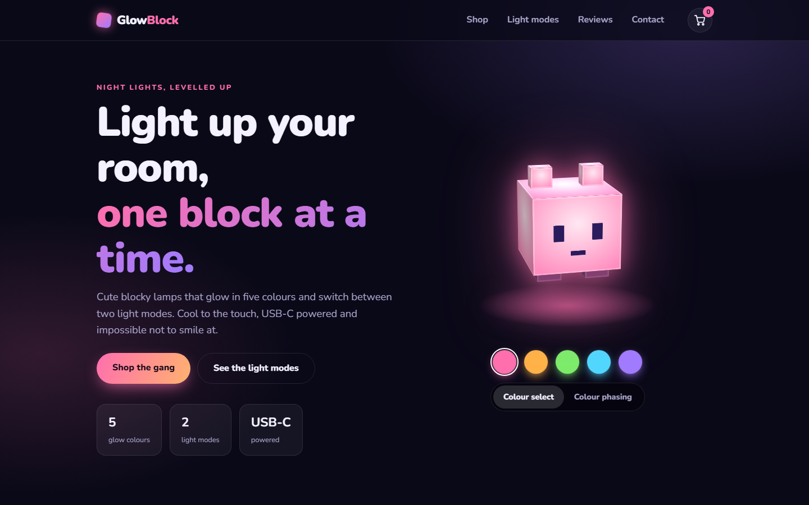
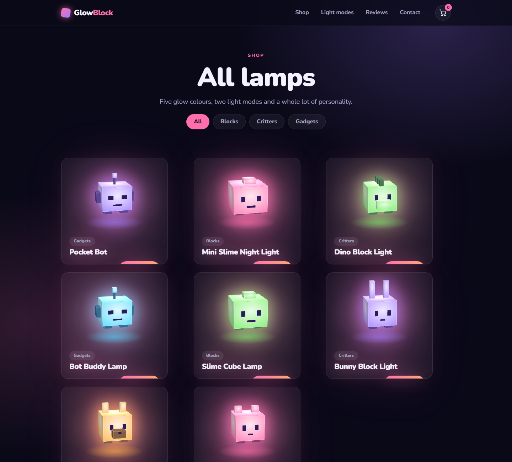
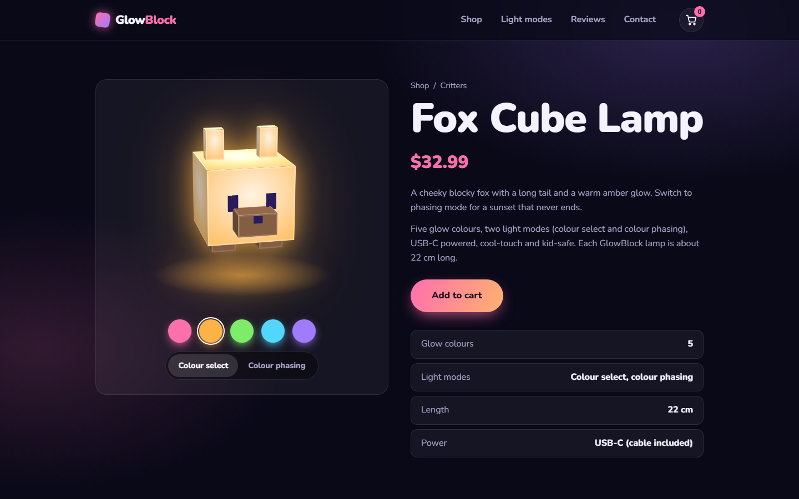
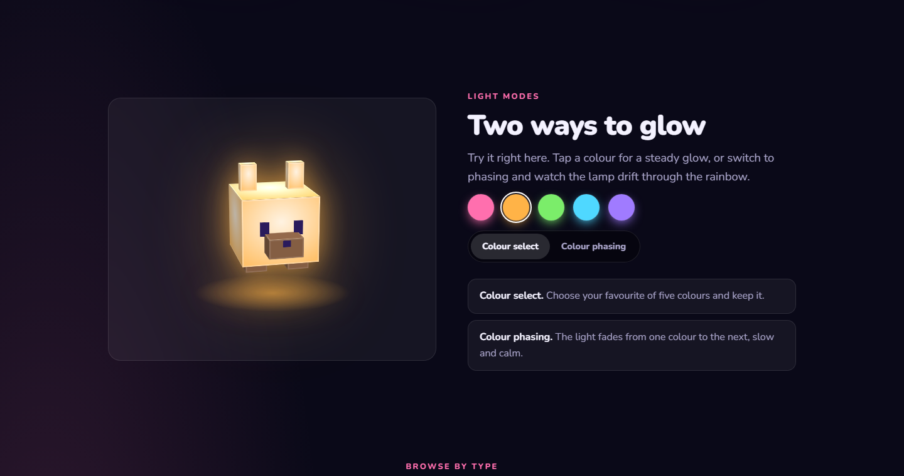
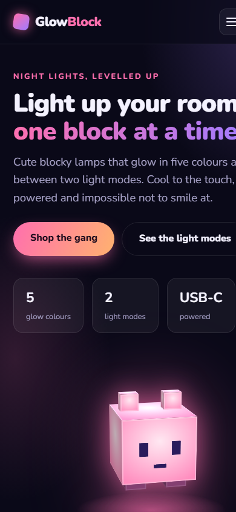

# GlowBlock: Custom WordPress Theme

A custom-built WordPress theme for a (fictional) blocky night-light shop. Every lamp is rendered in **pure CSS 3D**, with no images, and each one comes with five glow colours and two light modes: *colour select* and *colour phasing*.



## Highlights

- **Hand-coded theme**, no page builder and no starter theme
- **Custom post type "Lamps"** with its own meta box (price, character, glow colour, length)
- **Custom taxonomy "Collections"** (Critters, Blocks, Gadgets) with filter pills
- **3D lamps built from CSS cuboids**: six characters (cat, fox, bunny, slime, robot, dino) generated in PHP from a small part list
- **Interactive demo**: pick one of five colours, or switch to colour phasing and watch the lamp drift through the palette; lamps also tilt with the mouse
- Product pages, shop archive, collection pages, blog templates and a custom 404
- Demo cart with counter and toast notifications (front-end only)
- Fully responsive with a mobile menu, respects `prefers-reduced-motion`
- Demo content is created automatically the first time the theme runs

## Screenshots

| Shop | Product page |
|---|---|
|  |  |

| Light modes | Mobile |
|---|---|
|  |  |

Full page: [screenshots/06-full-page.png](screenshots/06-full-page.png)

## Installation

**Option A: upload the zip**

1. Download `glowblock.zip` from this repository.
2. In WordPress go to **Appearance → Themes → Add New → Upload Theme**.
3. Upload the zip, install and **Activate**.

**Option B: copy the folder**

1. Copy the `glowblock` folder to `wp-content/themes/`.
2. Activate **GlowBlock** under **Appearance → Themes**.

On first load the theme adds 8 demo lamps in three collections. If the lamp URLs show a 404, open **Settings → Permalinks** and click **Save Changes** once.

## Managing products

Go to **Lamps → Add New** in the WordPress admin. Set the title, description, and in the **Lamp details** box choose the price, the character, the default glow colour and the length. Assign a **Collection** on the right.

## Structure

```
glowblock/
├── style.css               theme header + all styles (3D cuboid CSS, layout)
├── functions.php           setup, custom post type, taxonomy, meta box, lamp renderer, demo content
├── header.php / footer.php
├── front-page.php          home page
├── archive-lamp.php        shop + collection archives
├── single-lamp.php         product page
├── template-parts/
│   └── lamp-card.php       product card
├── index.php, single.php, page.php, 404.php
└── assets/main.js          colour select / phasing, tilt, demo cart, mobile menu
```

## How the 3D lamps work

A lamp is a list of cuboids (`width, height, depth, x, y, z`). PHP prints each cuboid as a `<div>` with six face elements, and CSS places the faces in 3D with `transform: translate3d(...)`, `rotateX/Y` and `perspective`. The glow colour is a registered CSS custom property (`@property --glow`), so changing it smoothly animates every face, the shadow and the floor glow at once.

## Tech

PHP 8 · WordPress 6+ · HTML5 · CSS3 (custom properties, `@property`, `color-mix`, 3D transforms) · vanilla JavaScript

## Notes

GlowBlock is a fictional brand created for a portfolio. No real products are sold and the newsletter form does not send anything.

---

Built by Darijs Sivoha.
